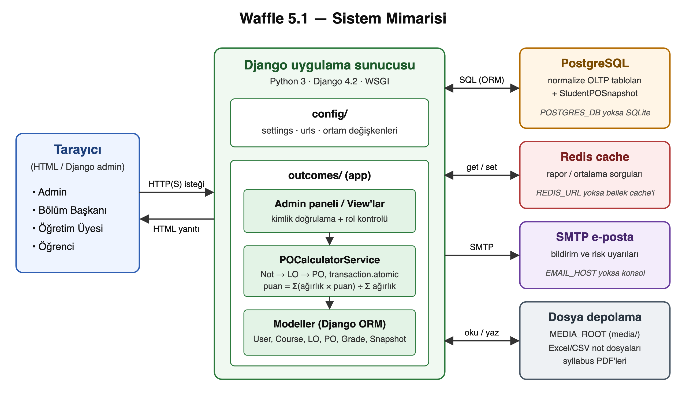
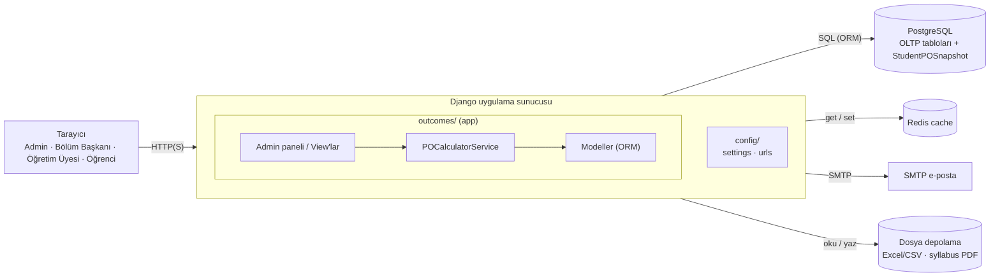

# Sistem mimarisi

Kaynak: `architecture.svg` (vektör), `architecture.png` (rapor ve slaytlar için).

## Bileşenler

| Bileşen | Görevi | Ayar (`config/settings.py`) | Tanımlı değilse |
|---|---|---|---|
| Tarayıcı | Dört rolün arayüzü (şimdilik Django admin) | — | — |
| Django | İstekleri karşılar, yetki kontrolü yapar, PO hesaplar | `INSTALLED_APPS`, `AUTH_USER_MODEL` | — |
| PostgreSQL | Kalıcı veri: normalize tablolar + ön hesaplanmış `StudentPOSnapshot` | `POSTGRES_*` | SQLite |
| Redis | Sık okunan rapor/ortalama sorgularının cache'i | `REDIS_URL` | Süreç içi bellek |
| SMTP | E-posta bildirimleri | `EMAIL_HOST` … | Konsola yazar |
| Dosya depolama | Toplu not Excel/CSV dosyaları, syllabus PDF'leri | `MEDIA_ROOT` | `./media` |
