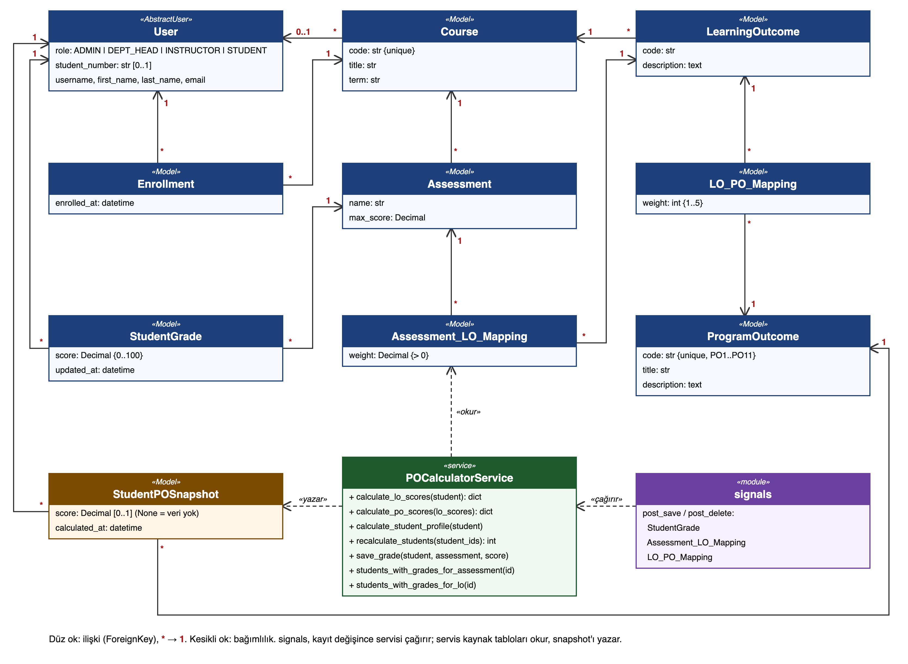

# Class diyagramı

Kaynak: `class.svg` (`python docs/diagrams/_gen_class.py` ile üretilir), `class.png` (rapor ve slaytlar için).

## Sınıflar

| Sınıf | Dosya | Sorumluluğu |
|---|---|---|
| `User`, `Course`, `Enrollment`, `LearningOutcome`, `ProgramOutcome` | `outcomes/models.py` | Kurumsal yapı: kim, hangi ders, hangi çıktı |
| `Assessment`, `StudentGrade` | `outcomes/models.py` | Değerlendirmeler ve ham notlar |
| `Assessment_LO_Mapping`, `LO_PO_Mapping` | `outcomes/models.py` | Ağırlıklar: değerlendirme → LO (katsayı), LO → PO (1–5) |
| `StudentPOSnapshot` | `outcomes/models.py` | Ön hesaplanmış PO profili; yalnızca servis yazar |
| `POCalculatorService` | `outcomes/services.py` | Not → LO → PO hesabı, snapshot yazımı, etkilenen öğrencilerin bulunması |
| `signals` | `outcomes/signals.py` | Not/eşleme/ağırlık değişince servisi çağıran tetikleyiciler |

## Hesaplama örneği (hocanın örneği, birim testi)

Her adımda `puan = Σ(ağırlık × puan) ÷ Σ ağırlık`.

| Adım | Hesap | Sonuç |
|---|---|---|
| LO1 | (0.60 × 90 + 0.40 × 80) ÷ (0.60 + 0.40) | 86.0 |
| LO2 | (0.40 × 90 + 1.00 × 80) ÷ (0.40 + 1.00) | 82.9 |
| PO1 | (2 × 86.0 + 1 × 82.86) ÷ (2 + 1) | 85.0 |
| PO2 | (2 × 82.86) ÷ 2 | 82.9 |
| PO3 | bağlı LO yok | NULL |

Hocanın örneğindeki LO→PO ağırlıkları 1.0 : 0.5 : 1.0'dır. Modelde ağırlık 1–5 tam sayı olduğu için aynı oran 2 : 1 : 2 olarak girilir; ağırlıklı ortalamada yalnızca oran önemli olduğundan sonuç aynıdır.

## Tetikleme akışı

1. `StudentGrade`, `Assessment_LO_Mapping` ya da `LO_PO_Mapping` kaydedilir veya silinir.
2. `signals` etkilenen öğrencileri bulur ve `POCalculatorService.recalculate_students` çağırır.
3. Servis `transaction.atomic` içinde öğrenci satırını `select_for_update` ile kilitler, puanları hesaplar, `StudentPOSnapshot` satırlarını günceller.
4. Hesaplama hata verirse değişikliğin tamamı geri alınır.
