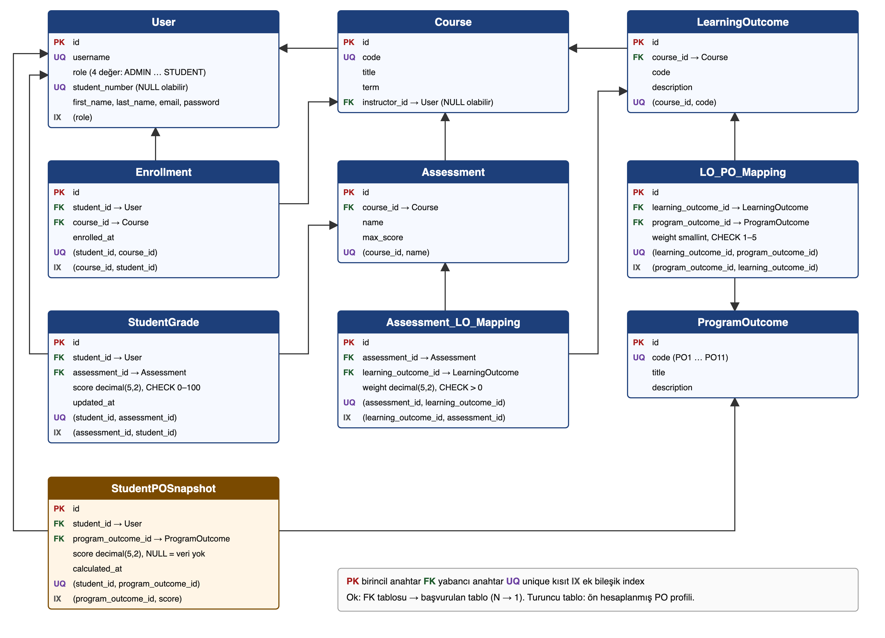

# ER diyagramı

Kaynak: `er.svg` (`python docs/diagrams/_gen_er.py` ile üretilir), `er.png` (rapor ve slaytlar için).

## Tablolar ve kısıtlar

| Tablo | PK | FK | Unique | Check | Ek index |
|---|---|---|---|---|---|
| `User` | `id` | — | `username`, `student_number` | — | `(role)` |
| `ProgramOutcome` | `id` | — | `code` | — | — |
| `Course` | `id` | `instructor_id → User` (SET NULL) | `code` | — | — |
| `Enrollment` | `id` | `student_id → User`, `course_id → Course` | `(student_id, course_id)` | — | `(course_id, student_id)` |
| `LearningOutcome` | `id` | `course_id → Course` | `(course_id, code)` | — | — |
| `LO_PO_Mapping` | `id` | `learning_outcome_id`, `program_outcome_id` | `(learning_outcome_id, program_outcome_id)` | `weight` 1–5 | `(program_outcome_id, learning_outcome_id)` |
| `Assessment` | `id` | `course_id → Course` | `(course_id, name)` | — | — |
| `Assessment_LO_Mapping` | `id` | `assessment_id`, `learning_outcome_id` | `(assessment_id, learning_outcome_id)` | `weight > 0` | `(learning_outcome_id, assessment_id)` |
| `StudentGrade` | `id` | `student_id → User`, `assessment_id → Assessment` | `(student_id, assessment_id)` | `score` 0–100 | `(assessment_id, student_id)` |
| `StudentPOSnapshot` | `id` | `student_id → User`, `program_outcome_id → ProgramOutcome` | `(student_id, program_outcome_id)` | — | `(program_outcome_id, score)` |

## Tasarım notları

- **Normalizasyon:** Kaynak tablolar 3NF'tedir; her ağırlık ve her not tek bir yerde tutulur.
- **`StudentPOSnapshot`:** Türetilmiş veridir (öğrenci × PO başına tek satır). Okuma yükünü hesaplamadan ayırmak için bilinçli olarak denormalize edilmiştir; `score = NULL` "henüz veri yok" demektir.
- **Index'ler:** Her unique kısıt bir yönü (ör. öğrenci → değerlendirme) karşılar; ek bileşik index ters yönü (değerlendirme → öğrenci) karşılar. FK sütunlarına Django kendiliğinden index koyar.
- **Silme davranışı:** Hoca silinirse ders kalır (`SET NULL`); diğer tüm FK'lar `CASCADE`.
