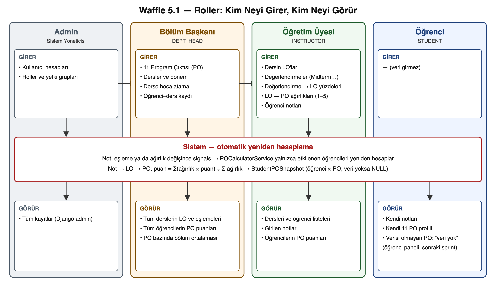

# Kullanıcı / rol akış şeması

Kaynak: `roles.svg` (`python docs/diagrams/_gen_roles.py` ile üretilir), `roles.png` (rapor ve slaytlar için).

## Roller

| Rol | Kod | Girer | Görür | Demo kullanıcısı (`seed_demo`) |
|---|---|---|---|---|
| Sistem Yöneticisi | `ADMIN` | Kullanıcılar, roller | Her şey | `admin` |
| Bölüm Başkanı | `DEPT_HEAD` | PO'lar, dersler, hoca ataması, öğrenci kaydı | Tüm dersler ve tüm öğrencilerin PO puanları | `baskan` |
| Öğretim Üyesi | `INSTRUCTOR` | LO'lar, değerlendirmeler, yüzdeler, LO→PO ağırlıkları, notlar | Dersler, notlar, PO puanları | `hoca.yazilim`, `hoca.veri`, `hoca.mat` |
| Öğrenci | `STUDENT` | — | Kendi notları ve PO profili | `elif` (hocanın örneği) ve 5 öğrenci |

## Şu anki durum

- Bölüm Başkanı ve Öğretim Üyesi yetkileri Django admin'de iki yetki grubu olarak tanımlıdır (`seed_demo` oluşturur).
- Yetki şimdilik model düzeyindedir: hoca tüm derslerin kayıtlarını görebilir. Sahiplik kontrolü (hoca yalnızca kendi dersi) ve öğrenci paneli sonraki sprintin işidir.
- `StudentPOSnapshot` admin'de salt okunurdur; puanları yalnızca hesaplama servisi yazar.
